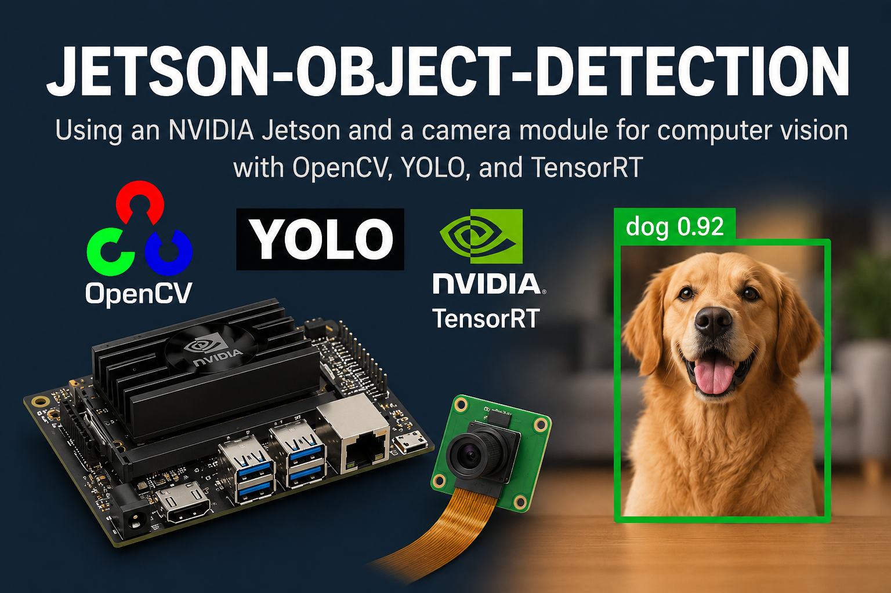

# jetson-object-detection

  



Following the success of my other project, [rpi-object-detection](https://github.com/automaticdai/rpi-object-detection), I am making this new project focusing on Nvidia Jetson. As many configurations are different on Jetson, I think this is a better way to have a new repo, rather than a hybrid integration to support multiple platforms. Due to the on-board GPU, with Jetson, I am going to produce more interesting CV-based projects.

Star the project and stay tuned!

## Hardware
This repo is developed with Jetson AGX Orin, and it should support the following hardware:

- Jetson AGX Thor (2025)
- Jetson Orin Nano Super (2024)
- Jetson AGX Orin (2023)
- Jetson Orin NX (2023)
- Jetson Orin Nano (2023)

Older boards are not supported by the detection demo, because it needs JetPack 6+ (Python 3.10, recent TensorRT and PyTorch):

- Jetson Xavier NX (2020)
- Jetson Nano (2019): `src/camera_test.py` works (tested on JetPack 4.6.1 with an IMX219 CSI camera), but `src/detect.py` does not.
- Jetson AGX Xavier (2018)
- Jetson TX2 (2017)
- Jetson TX1 (2015)
- Jetson TK1 (2014)

Note that this does not mean the code won't be able to run on these boards --- I just don't have the time and energy to test them.

## Requirements
- **JetPack 6.x** (Jetson Linux 36.x) for Orin boards, or **JetPack 7.x** for Jetson Thor. Check your version with `cat /etc/nv_tegra_release` or `apt show nvidia-jetpack`.
- **Python 3.10+** (the system Python that ships with JetPack).
- **OpenCV 4.x with GStreamer support**. JetPack's OpenCV already has this. Do **not** `pip install opencv-python`: the pip wheels are built without GStreamer, so CSI cameras won't open. Check with:
  ```bash
  python3 -c "import cv2; print(cv2.__version__); print([l for l in cv2.getBuildInformation().splitlines() if 'GStreamer' in l])"
  ```
- **For object detection:** [Ultralytics](https://docs.ultralytics.com/) with PyTorch and TensorRT built for Jetson. The easiest way is the Docker image (see [Object Detection](#object-detection)).
- **A camera**: a CSI camera (e.g. Raspberry Pi Camera Module v2 / IMX219) or a USB webcam.

## Quick Start: Camera Test
```bash
git clone https://github.com/automaticdai/jetson-object-detection.git
cd jetson-object-detection

# CSI camera (default). Press 'q' to quit.
python3 src/camera_test.py

# USB webcam
python3 src/camera_test.py --source usb

# Over SSH / no monitor: print FPS instead of opening a window
python3 src/camera_test.py --headless

# All options
python3 src/camera_test.py --help
```

## Object Detection
Live YOLO object detection with a TensorRT engine, showing FPS and a per-stage latency breakdown (capture / preprocess / inference / postprocess / draw).

### 1. Start the container
[`docker/run.sh`](docker/run.sh) runs the official Ultralytics Jetson image (pinned to a tested version) with GPU, camera and display access, and mounts this repo at `/app`:

```bash
xhost +local:docker   # once per login, so the container can open windows
docker/run.sh         # interactive shell; or pass a command, e.g. docker/run.sh python3 src/detect.py ...
```

It picks the image from your JetPack version (JetPack 6 → `*-jetson-jetpack6`, JetPack 7.0 → `*-nvidia-arm64`). Use `docker/run.sh --image IMAGE` to choose another one.

> The Ultralytics image ships `opencv-python-headless`, which has no window support and no GStreamer. Use `--headless` (and `--save out.mp4` to record the result), and a USB camera or video file. CSI cameras need an OpenCV with GStreamer, i.e. a [native install](#native-install-without-docker).

### 2. Build a TensorRT engine
Engines only run on the device and TensorRT version they were built with, so build them on the Jetson itself. This takes several minutes:

```bash
python3 src/export.py --model yolo11n --precision fp16    # -> models/yolo11n_fp16_640.engine
python3 src/export.py --model yolo11n --precision int8 --calib-data coco128.yaml   # INT8 needs calibration data
python3 src/export.py --help
```

### 3. Run detection
```bash
python3 src/detect.py --engine models/yolo11n_fp16_640.engine                     # CSI camera, window
python3 src/detect.py --engine models/yolo11n_fp16_640.engine --source usb --classes person,car --conf 0.5
python3 src/detect.py --engine models/yolo11n_fp16_640.engine --source video.mp4 --save out.mp4 --headless
```

Press `q` to quit. With `--headless`, FPS and stage timings are printed once per second instead. All camera options from `camera_test.py` (`--source`, `--width`, `--flip`, ...) work here too.

### Object tracking
Add `--track` to follow objects across frames: each box gets an ID that stays the same while the object is in view.

```bash
python3 src/detect.py --engine models/yolo11n_fp16_640.engine --track            # ByteTrack (default)
python3 src/detect.py --engine models/yolo11n_fp16_640.engine --track botsort    # BoT-SORT
```

Ultralytics installs the tracker's `lap` dependency on first use if it is missing, so the first run needs a network connection.

### Segmentation and pose estimation
Export a `-seg` or `-pose` model instead; `detect.py` reads the task from the engine and draws masks or skeletons:

```bash
python3 src/export.py --model yolo11n-seg --precision fp16     # instance segmentation
python3 src/export.py --model yolo11n-pose --precision fp16    # human pose (keypoints)
python3 src/detect.py --engine models/yolo11n-seg_fp16_640.engine
python3 src/detect.py --engine models/yolo11n-pose_fp16_640.engine --track
```

For INT8, `export.py` calibrates on `coco8-seg.yaml` / `coco8-pose.yaml` by default, because calibration needs masks or keypoints.

### Native install (without Docker)
Needed for CSI cameras and preview windows, because it keeps JetPack's OpenCV:

1. Install PyTorch and torchvision for Jetson, following [PyTorch for Jetson](https://docs.nvidia.com/deeplearning/frameworks/install-pytorch-jetson-platform/index.html). The default `pip install torch` wheels have no CUDA support on Jetson.
2. `pip install ultralytics` (see the [Ultralytics Jetson guide](https://docs.ultralytics.com/guides/nvidia-jetson/)).
3. Ultralytics pulls in `opencv-python` from pip, which hides JetPack's OpenCV. Remove it so the GStreamer build is used again:
   ```bash
   pip uninstall -y opencv-python opencv-python-headless
   python3 -c "import cv2; print([l for l in cv2.getBuildInformation().splitlines() if 'GStreamer' in l])"   # should say YES
   ```

## Troubleshooting
- **CSI camera fails to open** (e.g. `Failed to create CaptureSession`): check it is detected (`ls /dev/video*`), then restart the camera daemon with `sudo systemctl restart nvargus-daemon`. Stopping a program with Ctrl+C while it holds the camera can leave the daemon in this state.
- **"no GStreamer support"**: you are using pip's OpenCV. See [Native install](#native-install-without-docker).
- **"no GUI support"**: you are inside the Docker image. Add `--headless`.
- **Engine fails to load**: it was built on another device or TensorRT version. Rebuild it on this device with `src/export.py --force`.

## Development
The unit tests need no GPU or camera, and run on any PC (and in CI):

```bash
pip install -r requirements-dev.txt   # not on the Jetson: pip's OpenCV would hide JetPack's
pytest
```

## License
The code in this repository is released under the MIT License.

The detection scripts use [Ultralytics](https://github.com/ultralytics/ultralytics), which is licensed under **AGPL-3.0**. Using it in this demo is fine, but if you build a product on top of these scripts, the AGPL applies to it unless you have an [Ultralytics Enterprise License](https://www.ultralytics.com/license).
